# DIPCAN

**Dropped, Indexed, Passive Challenge-Answer Network.** Team 21, Code Metal Forge, Boston, November 2026.

A radio tells us where an isolated person is when they key it. DIPCAN tells us where they went while they stayed silent.

An isolated person drops small radio pucks, dipcans, as they move. Each one records the leg it was carried: steps, heading, and elevation. None of them transmit on their own. When a friendly team with the chain key asks, every dipcan answers in turn and the trail draws itself in ATAK. If an enemy picks one up, it wipes itself, and the gap in the chain says where the enemy was and when.

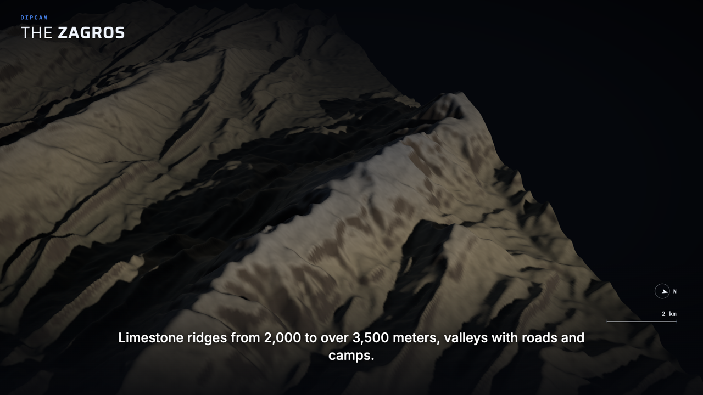

## What we built in 26 hours

- **An original hardware design and working prototypes.** Three dipcans and an interrogator on Adafruit Feather LoRa boards, a barometer, a nine-axis IMU, soldered antennas, pull-tab activation. Pairing, the chain, tamper, kill, and the slotted signed answers all verified over the air.
- **Four pieces of firmware.** The RP2040 dipcan, the 32u4 dipcan, the 32u4 LoRa bridge, and the ESP32 BLE bridge (parked once the IMU took over heading).
- **An Android interrogator app.** Drives the bridge over USB, signs challenges, orders the chain, and delivers it to ATAK on the same phone.
- **ATAK integration.** Cursor-on-Target markers and the route, on the map the team already carries.
- **A nine-minute explainer film** on real Zagros terrain, with three live tests shot in Boston.

About 5,000 lines of our own code, every one of them written after the Saturday 10:00 start.

## The story

April 2026. An F-15E is hit over the Zagros Mountains in southwestern Iran. Both crew eject. The pilot is picked up within hours. The weapons systems officer, call sign Dude 44 Bravo, is alone in the mountains for about two days and is recovered on April 5 by a force of 155 aircraft.

For two days he had to choose between staying hidden and being findable. His survival radio sends an encrypted burst over satellite. Every burst can be direction-found, it needs a view of the sky, and it says where he is only at the moment he keys it. So for most of two days he did not key it, and the team had nothing.

DIPCAN lets him go completely dark, never leave cover, and still leave a trail only friendlies can read.

| | |
|---|---|
| 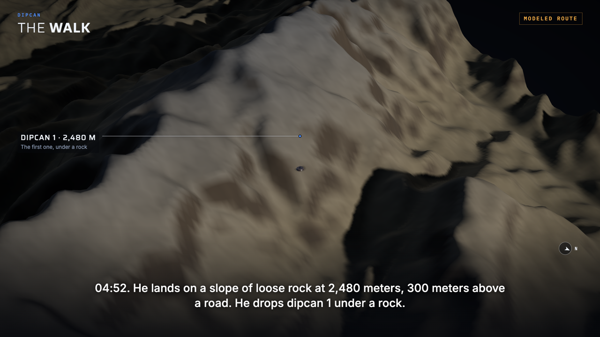 | 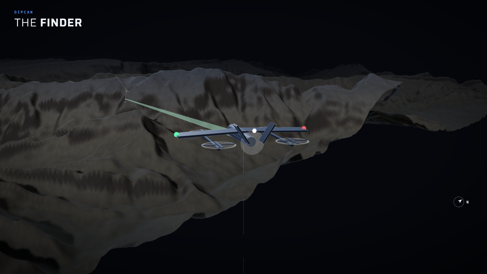 |
| 04:52. He lands on a slope of loose rock and drops dipcan 1 under a rock. Four dipcans over the night, 1.7 km and 460 m of climb, no transmit key pressed. At 15:10 a search party picks up dipcan 2 and it bricks. | 02:40, day two. A drone carries the interrogator to 15 km out and sends one signed challenge. |
| 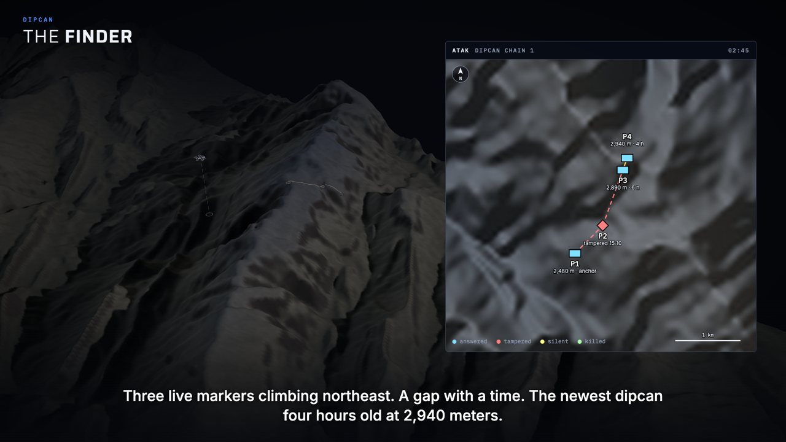 | 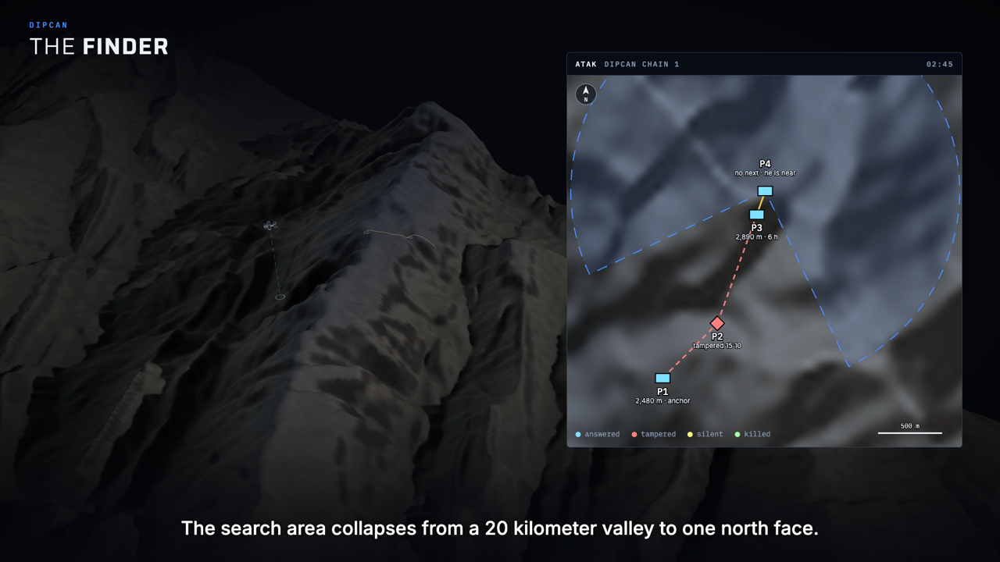 |
| Three answers, one gap with a time. The chain draws itself in ATAK on the phone the team already carries. | Dipcan 4 has no pointer to a next one, so he is close. The search area collapses from a 20 km valley to one north face. |

The walk is modeled. The terrain is real (AWS terrain tiles, 1 pixel per 65 m), and the elevations are read from it.

## How a dipcan lives

| | |
|---|---|
| 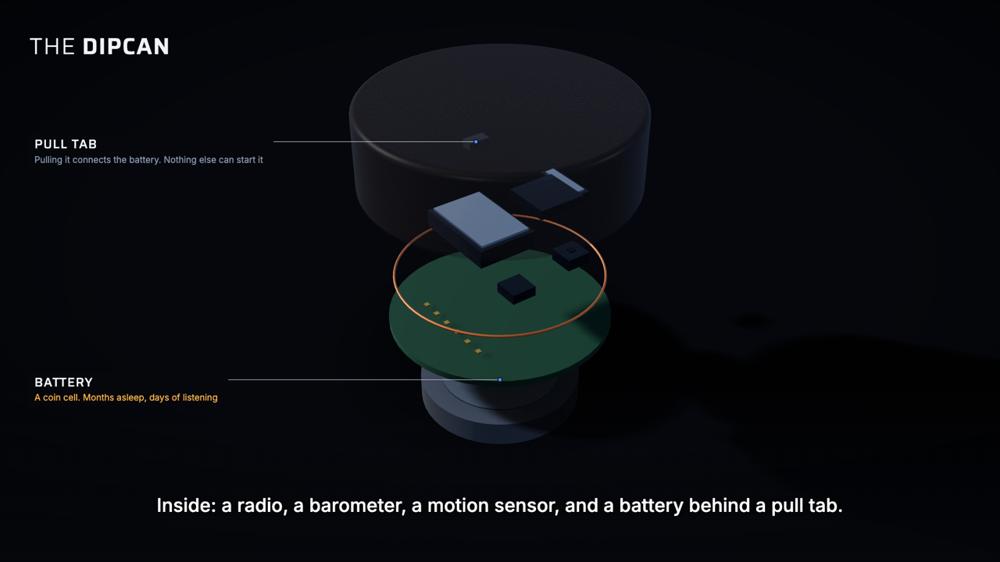 | 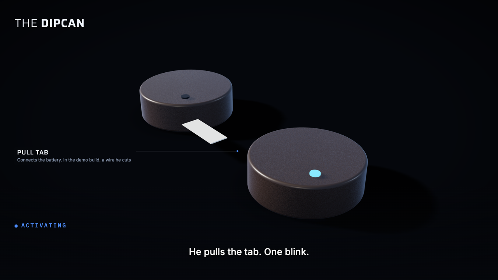 |
| 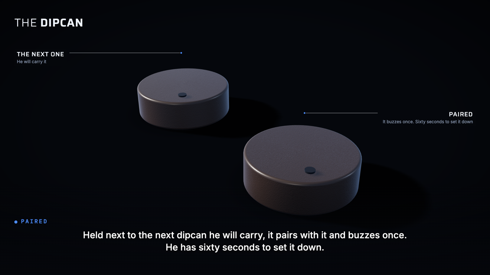 | 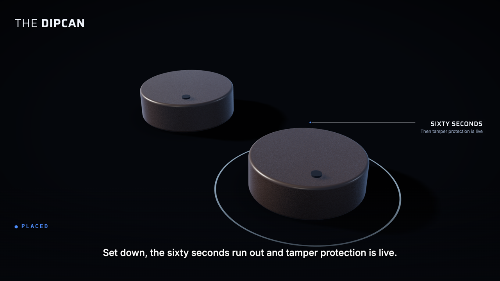 |

1. **Dormant.** In the vest with the pull tab in. Draws nothing, emits nothing.
2. **Activated.** Pull the tab (a jumper on the demo board). One blink. Held next to the next dipcan to be carried, it pairs with it and buzzes once. Sixty seconds to set it down.
3. **Placed.** The sixty seconds run out and tamper protection is live. Lift it and it wipes its keys and flash.
4. **Carried.** The next dipcan logs steps, heading, and barometric altitude as it travels. Radio off.
5. **The whisper.** When that one is set down it sends what it learned on the walk back to the dipcan before it, once, no louder than it has to be. Now both know the leg.
6. **Listening.** It answers one thing only: a challenge signed with the chain key the team holds. A replayed challenge gets nothing.

Each dipcan points at the next one, for three reasons. **Range:** LoRa reaches a few kilometers here; the finder cannot hear the last dipcan from the start, but each one puts them in range of the next. **Error:** dead reckoning drifts about ten percent of the walk, and standing on each dipcan resets it. **Survival:** if the person is taken or the last dipcan dies, the dropped ones still say where they were, when, and which way.

Two rules the finder reads on the phone. A dipcan that answers with no pointer to a next one means the person is close and still carrying the next: search every direction except the one you came from. The last dipcan in the vest carries a red mark, so a finder who sees it knows the trail ends there.

## What the team carries

The rescue element, a hostage rescue team, a search and rescue team, a helicopter, or a drone, carries the interrogator: a LoRa radio and an Android phone. The phone runs ATAK and a small companion app (`android-interrogator/`) that drives the radio over USB. The app signs one short question and sends it; each dipcan replies in the time slot its number gives it; the app checks every signature, orders the answers into a chain, and hands one marker per dipcan to ATAK with the route between them. After recovery, one signed kill command and every dipcan wipes itself for good. No computer sits between the radio and the phone.

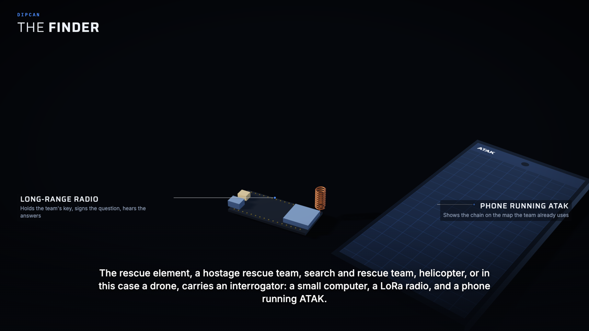

## Hardware

| | Demo build (this repo) | Production |
|---|---|---|
| Radio computer | Adafruit Feather RP2040 RFM95 or Feather 32u4 RFM95 (LoRa, 915 MHz) | Single board, LoRa at 915 MHz |
| Altitude | BME688 barometer, about 1 m | Barometer |
| Motion and heading | Seeed Grove IMU 9DOF (ICM20600 + AK09918), tilt-compensated | Accelerometer and magnetometer |
| Wake | A jumper pulled from the board, the demo pull tab | Pull tab |
| Pairing feedback | LED | Haptic buzz |
| Case | Plastic box, 96 by 66 by 32 mm | About the size of a bottle cap, about 15 g, about $15 |
| Interrogator | Feather 32u4 RFM95 bridge on USB, Android phone running ATAK-CIV and the companion app | Same, or carried by a Group 2 drone |

Parts list and sources: [`docs/Hackathon_Hardware_Details.pdf`](docs/Hackathon_Hardware_Details.pdf). Software bill of materials: [`SBOM.pdf`](SBOM.pdf). Bill of materials check against the production claims: [`docs/bom-check.md`](docs/bom-check.md).

What works, verified over the air during the build (details in [`ai/STATUS.md`](ai/STATUS.md)): pull-tab activation, hand-to-hand pairing and a three-node chain with the backward drop report, slotted answers to a signed challenge with replay rejection, barometric tamper that bricks the dipcan, signed kill, and a tilt-compensated compass. Duty-cycled receive and the homing mode are designed and parked.

## Film and photos

The explainer film (nine minutes, real Zagros terrain, narrated, with the three Boston live tests) is delivered with the submission; it is not in this repo. Stills from it are in `docs/media/`. Build photos: [`gallery/`](gallery/). How DIPCAN differs from fielded transponder systems: [`docs/novelty.md`](docs/novelty.md).

## Repo layout

```
firmware/
  common/packet.h     shared wire format, both sides build against it
  puck_feather/       Feather RP2040 RFM95 dipcan: activate, settle, listen, answer, tamper, brick
  puck_32u4/          Feather 32u4 dipcan, same chain lifecycle, minimal sensors
  bridge_feather/     Feather 32u4 LoRa bridge for the interrogator (RadioHead, moves bytes over USB)
  lib/Grove_IMU_9DOF/ vendored and patched Seeed IMU library
  build.sh            arduino-cli wrapper that bakes the chain key in from interrogator/.env
android-interrogator/ the phone app: drives the bridge over USB, signs challenges, orders the chain, feeds ATAK
interrogator/
  sweep.py            bench tool: sends signed challenges from a laptop or Pi
  chain.py            turns answers into an ordered chain with gaps
  cot.py              emits Cursor-on-Target markers and the route to ATAK (UDP multicast)
  packet.py           Python mirror of packet.h
gallery/              build photos
docs/                 COA, hardware list, build guide, stills, novelty and BOM notes
```

## Build and run

Firmware, interrogator setup, and the bench procedure are in [`docs/README-build.md`](docs/README-build.md). The short version:

```sh
firmware/build.sh puck 1 serial        # dipcan 1, USB-serial transport (bench)
firmware/build.sh puck 2 lora          # dipcan 2, over the air
cd interrogator && python3 sweep.py --port /dev/ttyACM0 --key <chain-key-hex>
```

On the phone, the companion app sends markers to ATAK on the same device (a UDP input on port 4242) and to the default multicast group. No server needed.

## The demo

1. The isolated person activates two dipcans at the table, drops one, walks the route from 60 State Street dropping three more, and sits out of sight. Nothing on any screen.
2. The rescue team walks the route with the phone and radio and presses sweep. Dipcans answer in turn; the chain draws in ATAK with elevation and an arrow from each to the next.
3. A judge picks up dipcan 3. Its marker turns "tampered" with the time, and the chain shows the gap.
4. The team presses kill. Remaining markers go gray.

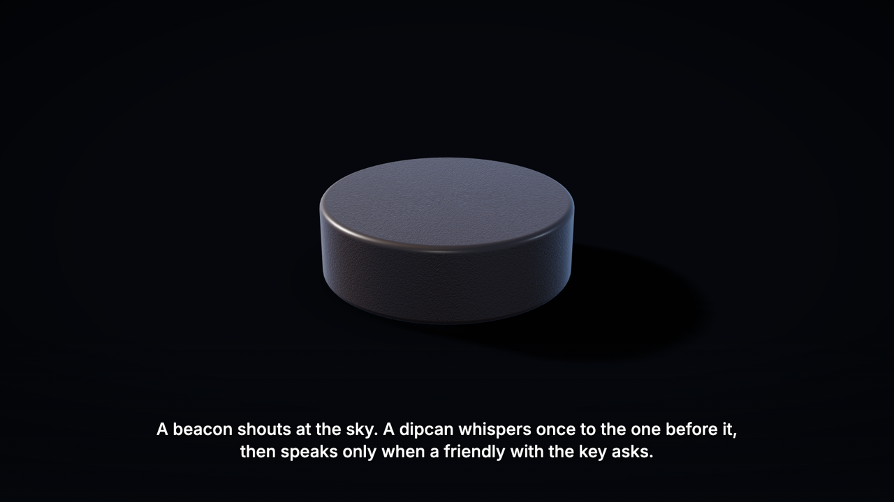

## Team

Team 21. Built Sat 10:00 to Sun 12:00, Nov 7 to 8, 2026, BASE-X Boston. What existed before: the COA document, [`docs/Team_21_COA_3.pdf`](docs/Team_21_COA_3.pdf). Everything in this repo was written during the build window. Design decisions and build notes for contributors: [`CLAUDE.md`](CLAUDE.md).
