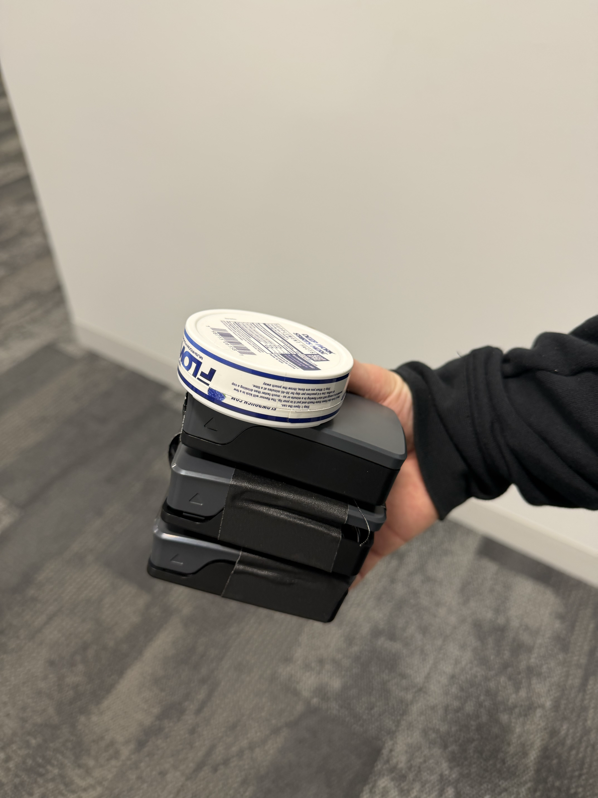
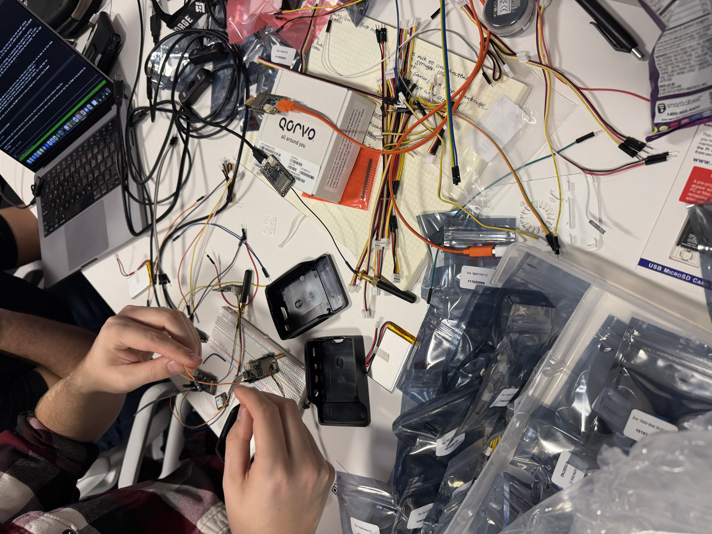
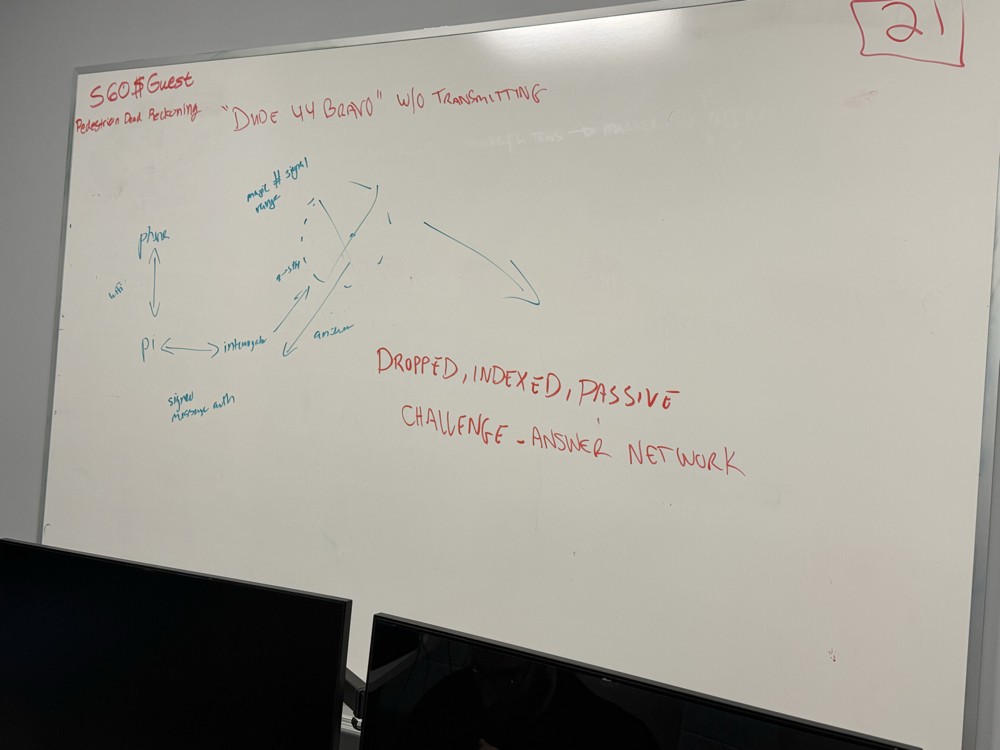
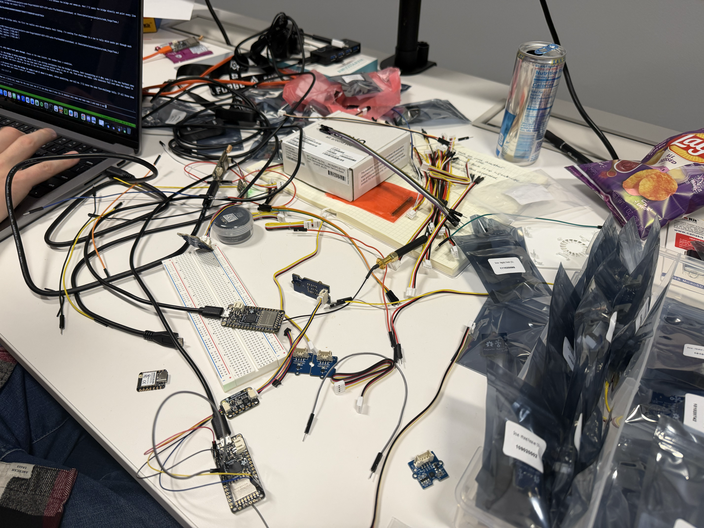
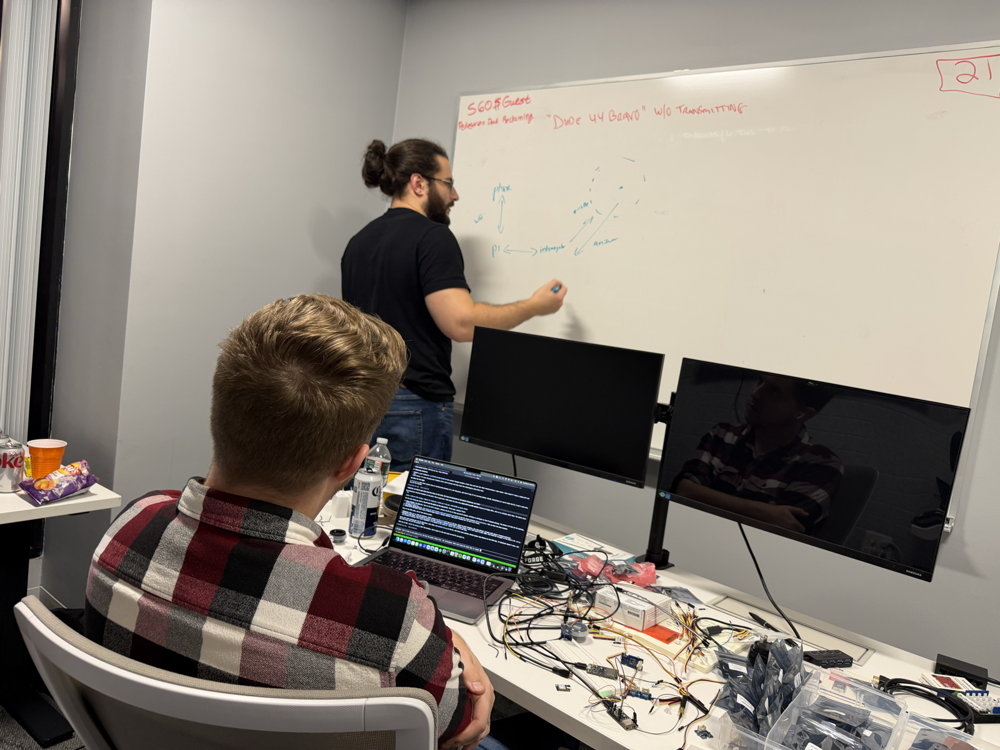
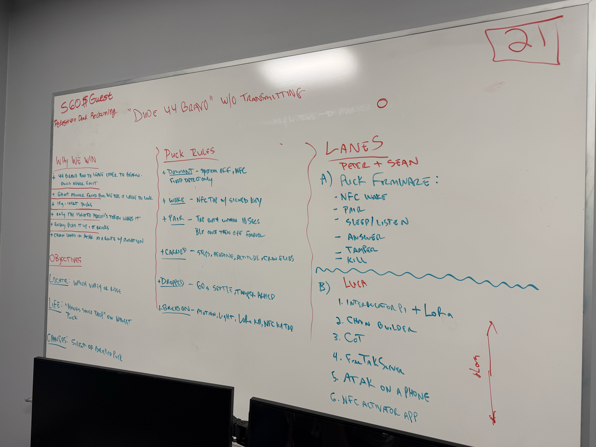
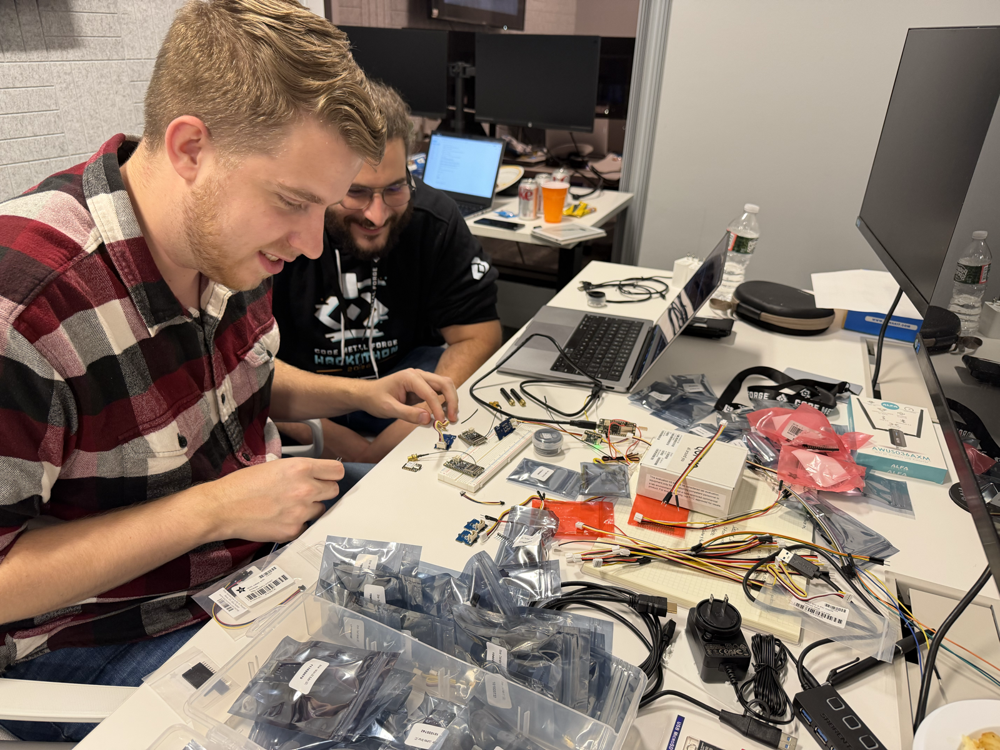
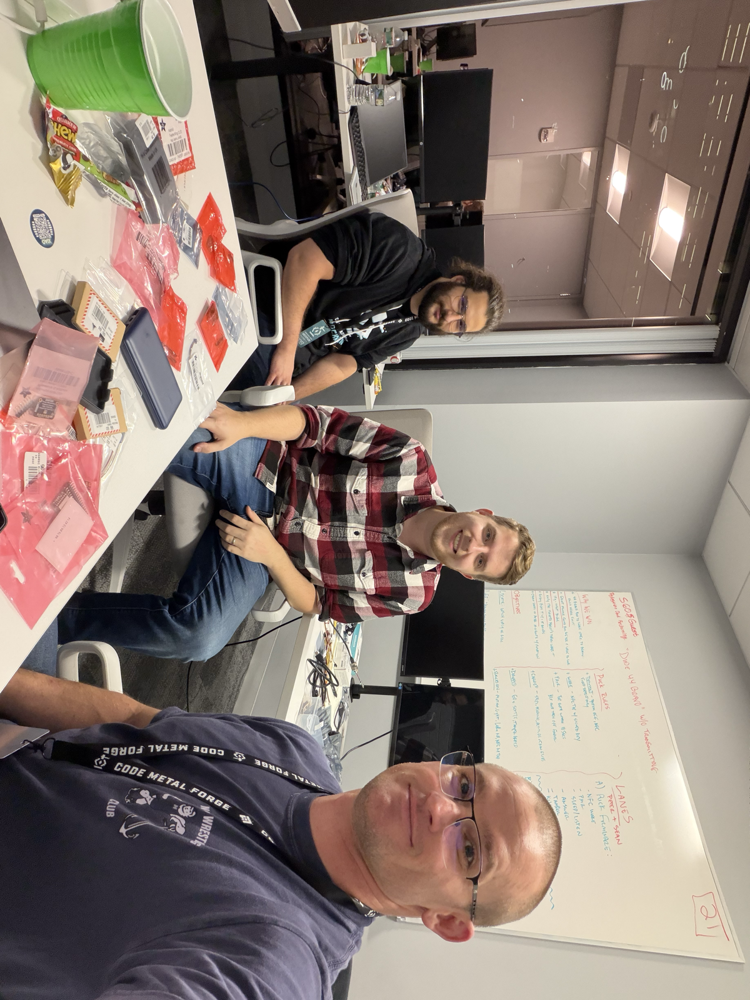
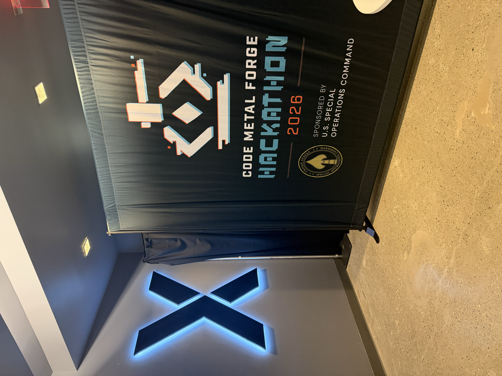

# Team 21 at the Forge

Photos from the build, Saturday 7 November to Sunday 8 November 2026, BASE-X Boston. Click any photo for the full size.

| | |
|---|---|
|  |  |
| Three demo dipcans, stacked, with a tin for scale. | Parts on the table before the first build. |
|  |  |
| The whiteboard: the Dude 44 Bravo chain, and the name spelled out. | Breadboards, Feather boards, and sensors mid-build. |
|  |  |
| Working the chain lifecycle at the board. | Lanes: puck firmware on one side, interrogator and ATAK on the other. |
|  |  |
| Antennas and sensors going on. | Team 21. |
|  | |
| Code Metal Forge Hackathon 2026, sponsored by U.S. Special Operations Command. | |
